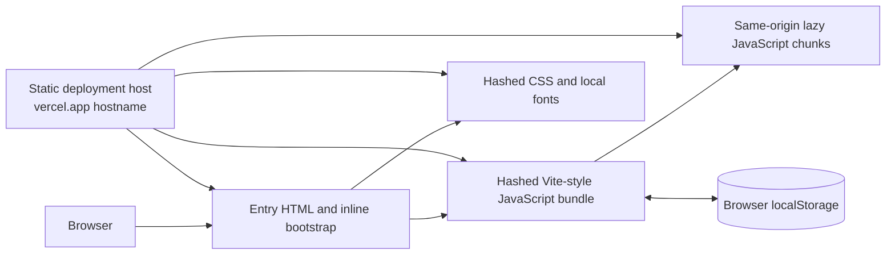
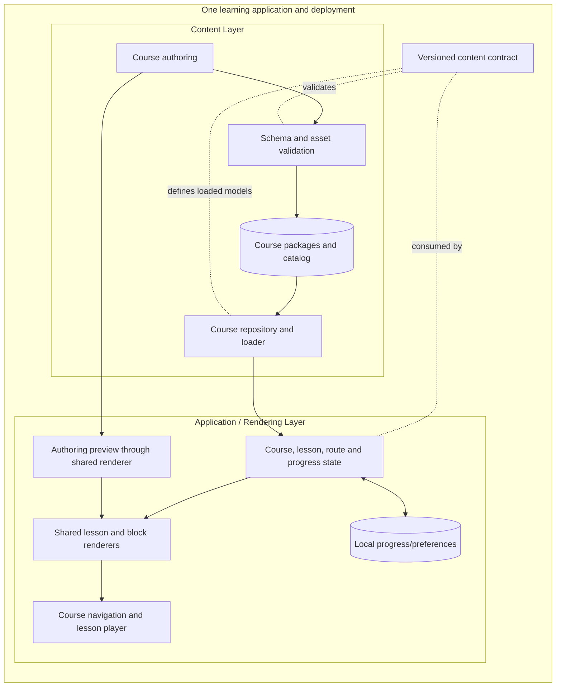

# Reusable, Content-Driven Learning Platform

**Project architecture and research blueprint**  
**Date:** 26 November 2026  
**Status:** Research synthesis and proposal; application implementation has not started.

## 1. Vision and requirements

Build one cohesive learning application with two logically independent layers joined by a shared content contract:

1. **Content Layer** consists of independently organized course folders and files, plus application modules that discover, load, validate, and supply their content to the renderer.
2. **Application / Rendering Layer** consumes that content and presents it through reusable learning components.

Both layers live in the same application and deployment. They have separate responsibilities, code organization, and dependency boundaries, but do not need separate applications or services. The course files follow the same agreed folder structure and content contract. This does not decide how authors create or edit those files, and does not require an authoring application or UI.

### Course folders and files

Keep courses independent so changes to one course do not require changes to another. A new course should mainly be added by creating its folder and providing content in the agreed format. For example:

```text
content/
├── kubernetes/
│   ├── course.yaml
│   ├── modules/
│   │   └── fundamentals/
│   │       ├── module.yaml
│   │       └── lessons/
│   └── assets/
├── docker/
│   ├── course.yaml
│   ├── modules/
│   └── assets/
└── signoz/
    ├── course.yaml
    ├── modules/
    └── assets/
```

This layout is an example, not a final decision. The exact folders and file formats will be chosen during architecture and implementation planning. Each course will have its own metadata, modules, lessons, learning material, and assets, while following the shared content contract. Each course declares a schema version identifying the content format it uses; this is not a version or release number for the course itself. The application validates course content against a supported schema version and clearly reports invalid content or unsupported versions. A migration mechanism is not a Version 1 requirement; consider one later only if an actual breaking schema change requires it.

### Reusable framework and reference experience

The reference application is our blueprint for Version 1. Our objective is to reproduce its existing user experience and functionality as closely as possible.

Do not independently invent, redesign, simplify, or omit UI components, interactions, layouts, or learning features. Before deciding what components to implement, use the reverse-engineering evidence to identify the reference application's actual:

- UI components and their responsibilities.
- Content presentation capabilities.
- Layout, spacing, and visual design.
- Navigation and interactions.
- Learning features and progress tracking.
- Supported content types.

Recreate these capabilities in our application framework while separating course-specific content from reusable application logic. The components and capabilities identified in the reference application form the initial supported framework; do not assume or introduce an arbitrary Version 1 component set. Base the initial implementation on verified reference capabilities. Record unverified behavior or implementation details as open research items instead of presenting assumptions as facts. See the [product capability inventory](reports/designed-to-scale/product-capability-inventory.md), [visualization inventory](reports/designed-to-scale/visualization-inventory.md), and [reference content model](reports/designed-to-scale/reference-content-model.md) for the current evidence and its confidence limits.

The reference shows Practice, Design Lab, and Cheatsheets as “coming soon”; these are not verified as working learning features. Reproduce functionality that is actually available, and preserve the observed unavailable or coming-soon states where relevant rather than inventing functionality for those sections.

For future extensions:

- A new course or lesson using existing framework capabilities requires content changes only; core application logic stays unchanged.
- If a future course needs a capability that the framework does not provide, implement it as a generic, reusable application component, not a course-specific renderer. Make it available to any course that needs it.
- Define the new capability's content representation or configuration in the shared content contract so any course can use it, while preserving compatibility with existing courses.

**Key principle:** First replicate what the reference developer has built. Then make that learning experience reusable across independently supplied courses. Extend the framework only when a genuine new capability is required.

The visualization inventory contains confirmed and representative patterns, not a complete specification of every reference visualization. Before finalizing the visualization renderer or its content representation, inspect representative reference scenes and compare their structures, state changes, animations, and controls. Treat proposed primitives and candidate data models as unfinalized until this comparison is complete. Record the findings of this investigation before finalizing the visualization architecture and content representation.

### Learner progress

Keep one learner progress experience and match the behavior observed in the reference. Course files describe all available lessons and their order; learner progress is separate data recording completed lesson IDs and the learner's current position. Where applicable, reproduce the observed module and course completion counts, last learning position, and recent lesson history. Match the behavior, not the reference's internal storage keys or implementation details. Do not add a second tracker or progress features without evidence or justification. Completing 4 of 10 lessons changes learner progress, not course files: all 10 lessons remain in the course package.

The first platform design must therefore support independent course folders, schema-versioned content, reusable application components, reference-aligned learning and progress behavior, responsive presentation, and clear content validation—without course-specific rendering branches or arbitrary course-supplied JavaScript.

## 2. Research basis and confidence

This document synthesizes the existing investigation in [`reports/designed-to-scale/`](reports/designed-to-scale/), the captured deployment assets, isolated REA browser replays on 26 November, and static analysis of the hash-matched deployment bundle. It does not claim access to the reference developer's private source repository.

Confidence labels:

- **Verified observation:** directly visible in the site, captured assets, or recorded browser behavior.
- **Inference:** best explanation of observed structure; not proof of the original source architecture.
- **Unknown:** evidence does not answer the question.
- **Recommendation:** design proposed for our platform, not a feature attributed to the reference.

The saved entry HTML and primary JS/CSS asset identities were checked against the live deployment on 25 November; the captured main JS and CSS SHA-256 values match the live files. The 26 November isolated page load rendered the same lesson and requested the HTML, hashed JS/CSS, local fonts, and favicon. This is a page-load observation, not a complete network audit.

REA analyzed the saved deployment directory as inert text (no application code execution), Evidence `ev_bf31ccc8b8e9b2490711f625774b511c7b970e1c6fed4ce0bfa36e3aaa6d09a6`. Analysis covered one JavaScript source and was partial for semantic graph relationships; the inline bootstrap in `index.html` was not analyzed. The previously configured REA CDP endpoint was unreachable, but REA-owned isolated Chromium replays were available for today's follow-up. Those replays supplement the saved artifacts; they do not provide access to the reference developer's source repository.

## 3. Reference application overview

The reference is **System Design**, a client-rendered, single-page interactive course deployed at `https://designed-to-scale.vercel.app/`. The captured curriculum has 9 modules, 40 lessons, and 445 reported steps. The lesson page combines a step-specific diagram, a timeline, a guide, objectives, metrics where relevant, and lesson controls.

### 3.1 Observed architecture



**Verified:** The entry HTML contains an `#app` mount point and loads a hashed ES module and stylesheet. The UI is built in the browser. The URL hash represents lesson and step navigation. Theme, language, last/recent lesson, completion, and progress-panel state use local storage. Course content is delivered in compiled JavaScript assets; no application API call was observed in the initial load or the saved reload captures.

**Inference:** The site is deployed as static assets on Vercel, based on its `vercel.app` hostname, hashed assets, and absence of an observed data service in tested flows. The original build pipeline and hosting configuration are unavailable.

### 3.2 Main components and responsibilities

| Component | Observed responsibility |
|---|---|
| Entry/bootstrap | Sets theme, initial language/direction, and layout before the app paints. |
| Header | Brand, Learn/Practice/Design Lab/Cheatsheets controls, search, language, theme, author link. Three secondary sections showed “coming soon” in tested flows. |
| Course tree | Module accordions, lesson selection, completion counts; turns into a drawer on narrower layouts. |
| Lesson player | Resolves lesson/step state, renders the header, diagram, timeline, guide, objectives, metrics, and pager. |
| Visualization stage | Renders inline SVG scenes and provides replay, pause, fit, and fullscreen controls. |
| Search | Searches lesson/step/concept results with keyboard navigation and deep-link selection. |
| Local state | Persists learner progress and preferences in browser storage; no account or sync was observed. |
| Locale resources | Loads translated interface and lesson content through same-origin JavaScript chunks. Exact chunk ownership is inferred from bundle mappings and observed locale loading. |

### 3.3 Learning experience

- **Navigation:** `#/lesson-id/step`; timeline, Back/Next, search, course tree, and browser history move between steps. Deep links restore tested lesson/step state.
- **Progress:** Reaching a tested recap marks the lesson complete and updates course/module counts. Completion is local; reset semantics are unknown.
- **Interactive presentation:** Animated SVG stage with pause/replay and fullscreen controls; lesson content changes by step. Fit/zoom details and some animation edge cases remain unverified.
- **Search:** Dialog/combobox results include recent, lesson, step, and concept groups; keyboard selection and empty state were tested.
- **Preferences:** Light/dark theme and language selection persist locally. The entry bootstrap applies theme and direction before first paint. The captured HTML lists 21 locale IDs and maps `yue` to Traditional Chinese; prior reports count the alias in their “22 locales” description.
- **Responsive behavior:** Desktop, tablet, and stacked/mobile layouts were directly exercised; the sidebar becomes a drawer on narrower layouts.
- **Offline/PWA:** A manifest exists. No active service worker or Cache Storage was observed in the tested context; offline behavior is not established.
- **Accessibility:** Semantic controls, roles, keyboard flows, and focus behavior are partially documented. A full accessibility audit was not completed.

### 3.4 26 November REA follow-up

These are controlled replays in provider-owned Chromium, not observations of the user's browser profile. Network capture included request/response metadata but not response bodies; only the declared paths, status, resource types, rendered accessibility trees, and tested UI states are established.

| Follow-up | Evidence | Finding and boundary |
|---|---|---|
| Initial page load | `ev_e65050ff4c3c9b5afdbac4f2531d7fdac5a841e513d68fb7f790ea7edc5beedb` | Eleven requests to the reference origin, all 2xx; page, scripts, stylesheet, fonts, manifest, and other resources. No console/page-error events were recorded. This is one page-load flow, not a complete API audit. |
| Completion and progress | `ev_14e902e5db3919a1fffe1d5270b049f5059f6f519c087c4699b6de2efbd29dc1` | Selecting the tested recap displayed `1 / 40` and `1/3` for Foundations; the expanded progress panel showed module counts and no reset control in that state. Storage values were hashed, so the exact persisted representation is not reported. This reconfirms the tested completion path but leaves reset behavior unresolved. |
| Spanish locale | `ev_13754a58c2e44f3c89bec60fb3edf445786e87959b98e2bf93cb1eca761a51fe` | Selecting Spanish translated the interface and lesson while keeping the route. Sixteen requests were observed, all same-origin and 2xx. Three script paths were `ui-BRJ4JvhW.js`, `request-lifecycle-C6fLr-m8.js`, and `latency-throughput-B4d-ZZqv.js`; no API origin was observed in this flow. This supports runtime loading of locale/lesson assets but not the contents of those responses or absence of APIs elsewhere. |
| Direct Spanish lesson route | `ev_4c20133c3e7db2b90212fbd9fef2df9baeae7d457e3aa31c1bd01a60f4596870` | Opening `#/caching/1` with Spanish selected rendered the Spanish Caché lesson (step 1 of 13) and its objectives/interactive stage. Fourteen requests, all same-origin and 2xx; the browser requested `assets/caching-CuJZmXh9.js` as a script and received 200. This confirms a route-named lesson asset is served alongside the rendered lesson, but the response body was not captured, so its exact contents remain unknown. |
| TTS implementation gate | Static observation in the captured bundle; runtime UI snapshot in `ev_e65050ff4c3c9b5afdbac4f2531d7fdac5a841e513d68fb7f790ea7edc5beedb` | The bundle contains speech-synthesis code but sets the `readAloud` feature gate to false; no speak control appeared in the initial accessibility tree. TTS therefore appears disabled in this deployed build. No exhaustive interaction/state check was performed. |

**A failed probe is not a product finding:** In a separate replay, the click locator for the translated Caché sidebar link timed out (`ev_4d5d07f6784cf6ac8d5f6f7cf91731ff5630ede37f686c4fbaceb9b3ca753ae8`). The Spanish UI and full course tree were captured before the timeout, but that failed click is excluded as evidence of lesson navigation. The direct-route replay above verifies the route independently.

REA launches used isolated, provider-owned Chromium processes that were cleaned up at scenario completion. The captures do not establish service-worker/offline behavior because REA's default launch environment blocks service workers. No response bodies were requested, so these captures do not independently reveal the data schema or exact content payload.

## 4. Reference technology stack

| Area | Finding | Confidence and boundary |
|---|---|---|
| Frontend | Client-rendered browser SPA | Verified from entry HTML, DOM, and runtime page. |
| Build output | Vite-style hashed ES module/CSS output and module-preload code | Verified fingerprint in the captured output; original build config is unavailable. |
| Language | Shipped application code is JavaScript | Verified. Whether original source was JavaScript or TypeScript is unknown. |
| UI framework | No React/Vue framework was identified; bundle code uses DOM APIs and HTML templates | Strong inference for a custom/vanilla DOM implementation, not definitive proof that no framework was used elsewhere. |
| Styling | Hashed CSS asset, custom class-based layouts/animations, local JetBrains Mono fonts | Verified in captured assets. No UI styling library was identified. |
| Content authoring | No CMS, authoring UI, or formal published schema was observed | Verified only within the public app and captured artifact scope. |
| Content representation | English curriculum and lesson records appear as JavaScript data objects; locale-specific chunks are dynamically imported | Bundle observation plus runtime corroboration. Exact original source files and editorial workflow are unknown. |
| Data storage | Static same-origin JS assets for course data; `localStorage` for preferences/progress | Verified for observed assets and keys. No remote content API was observed in tested flows. |
| Backend/API | No application API was observed in the initial page load or saved reload capture | Bounded negative result; not proof no backend exists for untested flows. |
| Hosting | `vercel.app` URL and static-looking assets | Hostname verified; Vercel deployment pipeline/configuration is unknown. |
| Other | Web app manifest, inline SVG, browser history/hash routing | Verified. Service-worker/offline behavior is unknown. |

## 5. Course structure and content management in the reference

### 5.1 What the evidence shows

The captured bundle defines a module array containing the 9 module IDs and their lesson IDs/titles, plus lesson records containing metadata and ordered step data. A lesson record can include:

- ID, title, summary, duration, level, metric keys, and objectives.
- An ordered `steps` array with step title, chapter, heading, body, callout/change notes, metrics, and a scene state.
- Scene data describing entities, links, and animation flows.
- Recap and next-lesson content.

The renderer uses a shared stage/control shell and generic-looking scene primitives (for example blocks, devices, databases, queues, connections, and flows). The presentation is consistent, but it does not prove that every possible subject can be represented without renderer changes.

The main bundle contains a large dynamic-import map: 820 unique chunk targets in the captured asset—20 targets per each of 40 lesson slugs, plus 20 UI-locale targets. The names and REA's locale replay support dynamically loaded localized UI/lesson assets; this remains an inference about chunk roles, not a recovered source schema. The English course definitions are present in the main bundle. During the Spanish selection replay, the browser requested the UI chunk and chunks named for the current and next lessons; a direct route to Caché requested `caching-CuJZmXh9.js` with status 200. This corroborates per-lesson chunk delivery, but without response bodies does not establish which lesson data, UI code, or both each chunk contains.

### 5.2 How a new reference course appears to be added

The public evidence does **not** show a supported “upload a course” workflow, runtime course registry, or content-only publishing interface. The observed bundle has one System Design curriculum and its lesson data compiled into the application assets. Therefore:

- A new course is **not demonstrated to be addable by supplying content alone**.
- At minimum, the observed design appears to require adding course/module/lesson data to the source build and publishing updated assets.
- New or translated lesson chunks may also need to be generated and included in the build.
- New visualization behavior beyond the shared scene model may require application logic.

These are evidence-based inferences from the shipped bundle; because the original repository/build pipeline is unavailable, the exact developer workflow and whether the source data was authored in separate files before bundling remain **unknown**. We should reuse the reference’s learning experience, not assume its content-delivery architecture meets our no-code course requirement.

## 6. Proposed architecture for our platform

### 6.1 System boundary

The target is one cohesive application with two internal layers. The content contract is the interface between them: authoring and validation produce conforming course packages, and the renderer consumes validated course data. The diagram shows responsibility and data flow, not separate deployments or services.



### 6.2 Content contract and authoring format

**Recommendation:** Use a versioned, data-only package with a small course manifest and separate module, lesson, and asset files. YAML and Markdown with typed YAML/JSON payloads are candidates, not a finalized format. Validate content against the shared contract before preview or publishing.

This balances readability for course authors with strict validation and generic rendering. Do not use MDX or arbitrary JavaScript as the default content format: authors should express content, not import application components.

The authoring interface should provide course metadata editing, a module/section/topic/lesson outline, a lesson and typed-block editor, diagram and asset management, locale status, validation feedback, a preview through the shared renderer, and a publish/version action. Implement it as an internal feature/route of the same application. Authoring and learner access can have separate routes and permissions, but they share the application boundary and deployment.

Do not define the Version 1 content types from a speculative starter list. Derive the supported schema and renderers from the reference capabilities established in the reverse-engineering evidence, including the [product capability inventory](reports/designed-to-scale/product-capability-inventory.md) and [visualization inventory](reports/designed-to-scale/visualization-inventory.md). Treat inferred or unverified details as open questions rather than silently making them Version 1 requirements. A later course may reveal a genuine missing capability; add it once as a generic renderer and contract type, never as a course-specific branch.

Every course manifest includes a schema version. The Content Layer validates each course against a version supported by the application and clearly reports invalid content or an unsupported version. Additive content types should preserve existing course compatibility where possible. Do not build a migration framework in advance; decide how to handle migrations if an actual breaking schema change arises.

For diagrams and animations, use the behavior and presentation observed in the reference to define the Version 1 contract. The exact data shape remains an implementation decision to validate against representative reference scenes; do not make an additional diagram format or renderer a Version 1 requirement without evidence. A new course using supported capabilities remains content-only; a genuinely new generic interaction capability extends the shared renderer, not a course-specific implementation.

Illustrative package shape (not a final folder or file-format decision):

```text
content/
  kubernetes/
    course.yaml             # metadata, including schemaVersion
    modules/
      fundamentals/
        module.yaml
        lessons/
          pods-and-deployments.md
    assets/
  docker/
    course.yaml
    modules/
    assets/
  signoz/
    course.yaml
    modules/
    assets/
```

The exact package layout and file formats remain to be decided. Whatever format is chosen, use the same structure and schema rules for every course. Validate stable IDs, references, required fields, content type declarations, supported locales, diagram node references, and asset paths before publication. Keep the source locale complete; allow translations to fall back to it. Return clear errors for malformed files, missing references, and unsupported schema versions.

### 6.3 Data flow and adding a course

1. An author creates a course in the Content Layer using the authoring area of the same application (or its initial file-based workflow).
2. The authoring feature edits the manifest, hierarchy, lesson prose, typed blocks, diagrams, and assets.
3. Schema validation checks IDs, ordering, references, block payloads, accessibility metadata, translations, and assets.
4. The preview loads the package through the same loader and renderers used by learners.
5. Publication saves a package version and updates the catalog through the application's content repository; it does not require a separate service.
6. The Content Layer repository loads the selected manifest and lesson payloads and validates compatibility against the contract; the Application / Rendering Layer consumes those models and renders them using shared components.
7. Course create/update/remove operations persist through the Content Layer's repository adapter; choose its backing store during implementation. Keep learner progress separate from course packages and use one reference-aligned progress experience, with course-scoped state such as completed lessons and current position. Browser storage is an initial option; add account/sync support only if required.

**No-core-rendering-change acceptance test:** Create a second, deliberately different course using only the Content Layer and existing content types; publish it; confirm the same application can discover and render it without edits to core rendering/application logic. If course data is bundled with the app, its normal release may still be required. Track any required renderer changes as a reusable platform capability, never as a course-specific exception.

## 7. Recommended implementation stack

These are recommendations for our platform, not technologies attributed to the reference.

| Layer | Recommendation | Reason |
|---|---|---|
| Application | One React + TypeScript + Vite application with internal Content Layer and Application / Rendering Layer modules | Reusable typed UI and clear dependency boundaries without splitting the product into separate applications or deployments. |
| Authoring | An authoring route/feature within the same application, using the shared contract and renderer for preview | Supports course creation and validation within the application's boundary; permissions can distinguish authors from learners. |
| Routing | React Router with course/lesson/step route segments | Supports deep links, history, and a course namespace; route identity should include course ID. |
| Styling | CSS Modules plus design tokens and logical CSS properties | Keeps the renderer themeable and responsive without requiring course-specific styles. |
| Content | YAML + Markdown for human-authored metadata/prose; JSON/YAML typed payloads for interactions | Readable authoring with machine validation; no executable course source. |
| Validation | JSON Schema 2020-12 + AJV; shared/generated TypeScript types | One contract can be checked in authoring, CI, publishing, and loading. |
| Rich text | `unified`/`remark` pipeline with a constrained plugin set | Converts Markdown to a known block model and supports safe previews. |
| Reference-supported content and examples | Render only through presentation capabilities confirmed in the reference inventory; defer any additional code/command component until verified or approved as a future generic extension | Keeps the Version 1 component set evidence-based and course content separate from renderer logic. |
| Diagrams | Reproduce the reference's observed diagram and animation behavior; finalize renderer and data format against representative scenes | Preserves the reference experience without assuming an additional diagram format or arbitrary primitive set. |
| Course delivery | Versioned JSON/Markdown/assets packages and a catalog managed by the Content Layer; the loader reads them through the contract | Keeps data out of rendering logic and supports content updates through the same application's normal release process. |
| Authoring source of truth | An internal repository interface persists create/update/remove operations; its backing store is chosen for the implementation and remains inside the application's architecture | Supports real authoring operations without introducing a separately deployed authoring product or service. |
| Progress | One course-aware tracker with learner state stored separately from course files; browser storage is an initial option | Preserves the reference experience and prevents learner completion state from modifying course content. |
| Hosting | One application deployment containing authoring, content access, and learner rendering | Keeps both layers in one cohesive application. The content repository's persistence mechanism is an implementation decision; a separate web app or service is not required. |

## 8. Proposed repository structure

```text
/
├── src/
│   ├── app/                      # one application shell and route composition
│   ├── content-layer/
│   │   ├── authoring/            # course editor and authoring workflows
│   │   ├── contract/             # schema definitions and compatibility checks
│   │   ├── validation/           # schema, link, asset, and locale checks
│   │   ├── repository/           # catalog/package persistence and loading
│   │   └── publishing/           # in-app package/catalog updates
│   ├── application/
│   │   ├── domain/               # route, progress, search, and preference state
│   │   └── rendering/            # shared lesson, block, and visualization renderers
│   └── design-system/            # shared accessible UI primitives and tokens
├── content/                      # illustrative; final package layout is undecided
│   ├── catalog.yaml
│   ├── kubernetes/
│   │   ├── course.yaml           # includes schemaVersion
│   │   ├── modules/
│   │   └── assets/
│   ├── docker/
│   └── signoz/
├── tooling/
│   └── validate-content/
└── tests/
    ├── content-contract/
    └── course-rendering-fixtures/
```

Both layers are modules in the same application project. Each independent course folder contains its metadata, modules, lessons, learning material, and assets; the example tree is not final. The Content Layer validates and supplies those files through the shared contract. Learner progress remains separate from course files. Routing, progress behavior, search, responsive layout, and rendering belong to application modules. Course packages are data only and must not import application components or renderer internals.

## 9. Implementation roadmap

1. **Product and authoring decisions:** identify author roles, review/publishing permissions, and localization needs; document course requirements that fall outside the reference-backed framework for a separate future capability decision.
2. **Content contract:** decide the folder/file structure and define course metadata (including schema version), module/section/lesson/step schemas, and the Version 1 content types established by the reference capability inventory.
3. **Content validation and preview:** implement schema/version checks, reference/asset checks, clear errors for unsupported or invalid content, and a preview powered by the production renderer.
4. **Application foundation:** recreate the reference's shared shell, visual design, course navigation, lesson player, step timeline, guide, interactions, progress presentation, responsive behavior, and accessibility as closely as possible, driven by course content.
5. **Content Layer MVP:** add the authoring area, schema validation, supported content blocks, asset management, and preview through the shared renderer within the same application.
6. **Content publishing and discovery:** add/update/remove packages through the in-app content repository and verify course onboarding without changes to core rendering logic. A normal application release may be needed when content is bundled.
7. **Learning features:** implement the reusable content types and capabilities established by the reference inventory, plus the single reference-aligned progress experience with learner state outside course files. Test that compatible framework extensions do not invalidate existing course packages.
8. **Operational readiness:** add error/loading states, content review workflow, accessibility checks, performance budgets, and optional identity/progress sync only if required. Defer migration tooling until a real breaking schema change requires it.

Do not begin with a universal diagram language or a backend CMS. Keep the content format as small as the reference's actual capabilities allow, but do not narrow Version 1 by omitting reference features. Keep the detailed schema open where evidence is incomplete and validate it against representative lessons and scenes.

## 10. Verified findings, assumptions, and unanswered questions

### Verified findings

- The reference is a client-rendered SPA with hash-based lesson/step navigation and a shared lesson-player layout.
- The captured course has 9 modules, 40 lessons, and 445 reported steps.
- The primary JS/CSS assets in the saved capture match hashes recorded from the live site on 25 November.
- Lesson data includes structured step text, objectives, metrics, callouts, and scene descriptions in the captured bundle.
- The shipped bundle contains many same-origin dynamic-import targets; initial loading and locale behavior are supported by saved network/runtime observations.
- Theme, language, progress, recent, and last-visited state are stored in browser local storage.
- The 26 November REA initial-load replay displayed the expected lesson and made 11 same-origin requests, all 2xx; it did not demonstrate an API call in that flow.
- The 26 November REA Spanish replay translated UI and lesson content in place and fetched three named JavaScript chunks, all same-origin; a direct Spanish deep link rendered the Caché lesson and requested `caching-CuJZmXh9.js` (200). API absence and chunk payload contents remain unverified outside the captured metadata.
- A controlled recap action updated visible course progress to 1/40; the tested progress panel exposed no reset control, without resolving reset behavior elsewhere.
- The TTS implementation is present in the saved bundle but gated off in that build; the initial UI snapshot has no speak control.

### Assumptions/recommendations for our design

- Keep the catalog and course repository inside the application boundary; the initial backing store may be versioned files or an app-managed store. A separate content service is not required.
- Keep content package versions compatible with explicit renderer/schema versions.
- Provide a structured authoring UI backed by the Content Layer repository; Git-backed course files are one possible source of truth, not a separately deployed authoring product.
- Require a second course to pass the no-core-code-change test before declaring the architecture content-driven.

### Unanswered questions

- What authoring roles, review/approval workflow, and publishing permissions are needed?
- Which persistence adapter should the in-app Content Layer use for creating, updating, and removing course packages?
- What final folder/file structure and content format should every course use?
- Which schema versions should the application support, and what compatibility window is needed when the schema changes?
- Should content updates be immediate at runtime or released through staged package versions?
- If a future course needs exercise interactions beyond the reference-backed framework, should they execute commands or only simulate/illustrate them?
- Which translations are required at launch, and who maintains them?
- Is learner progress local-only, exportable, or synchronized across devices?
- What requirements exist for offline use, account access, analytics, and learner data retention?
- Which visualization types are essential for the first courses, and what accessibility descriptions do they require?
- For the reference, the original source tree, package manifest, formal content schema, course-authoring workflow, exact build/deployment pipeline, complete API surface, response payloads for today's captures, and source-level localization contract remain unavailable or unverified.

## 11. Research references

- [`reports/designed-to-scale/REPORT.md`](reports/designed-to-scale/REPORT.md) — consolidated observations and limits.
- [`reports/designed-to-scale/investigation-status.md`](reports/designed-to-scale/investigation-status.md) — reconciled feature evidence and pending areas.
- [`reports/designed-to-scale/application-architecture.md`](reports/designed-to-scale/application-architecture.md) — architecture findings and unknowns.
- [`reports/designed-to-scale/reference-content-model.md`](reports/designed-to-scale/reference-content-model.md) — candidate hierarchy, explicitly not the reference's proven schema.
- [`reports/designed-to-scale/content-vs-application-analysis.md`](reports/designed-to-scale/content-vs-application-analysis.md) — observed content/application boundary.
- [`reports/designed-to-scale/reusable-platform-architecture-proposal.md`](reports/designed-to-scale/reusable-platform-architecture-proposal.md) — prior target architecture proposal.
- [`reports/designed-to-scale/routes-and-navigation.md`](reports/designed-to-scale/routes-and-navigation.md) and [`learner-experience.md`](reports/designed-to-scale/learner-experience.md) — route and learning behavior.
- [`reports/designed-to-scale/data-and-persistence.md`](reports/designed-to-scale/data-and-persistence.md) and [`network-and-integrations.md`](reports/designed-to-scale/network-and-integrations.md) — state, network, and API limitations.
- [`reports/designed-to-scale/evidence/live-2026-11-25/index.html`](reports/designed-to-scale/evidence/live-2026-11-25/index.html), [`index-BeXJu_A0.js`](reports/designed-to-scale/evidence/live-2026-11-25/index-BeXJu_A0.js), [`index-CxX-BAVx.css`](reports/designed-to-scale/evidence/live-2026-11-25/index-CxX-BAVx.css), and [`asset-freshness.json`](reports/designed-to-scale/evidence/live-2026-11-25/asset-freshness.json) — captured deployment assets and their recorded identity.
- [`reports/designed-to-scale/lessons-raw.json`](reports/designed-to-scale/lessons-raw.json) — extracted lesson list and step names.

