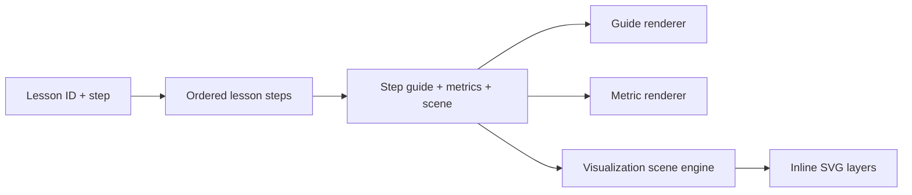
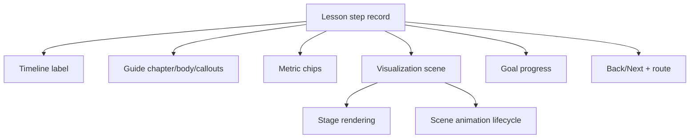
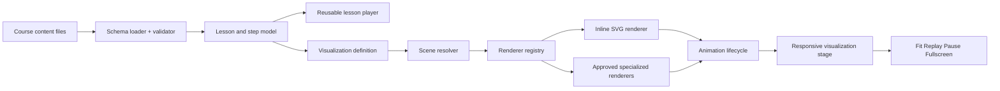

# Visualization Deep Dive

**Status:** Evidence-backed investigation
**Date:** 26 November 2026

## 1. Investigation scope and methodology

This investigation answers how the reference application's visualization system is rendered, changed, animated, controlled, and related to lesson content. It is a research-only report. No application code or existing report was modified.

The evidence base is:

- Existing reports in `reports/designed-to-scale/`, especially:
  - `visualization-inventory.md`
  - `product-capability-inventory.md`
  - `reference-content-model.md`
- The hash-matched captured JavaScript and CSS bundles.
- Runtime and DOM probes in `q4-steps.js`, `q21-speak.js`, `q22-mobile-metrics.js`, `q23-anim-css.js`, `q24-reading.js`, and related `q*.out.json` files.
- Desktop, tablet, and mobile accessibility/layout snapshots.
- 26 November REA Chromium replays and recorded evidence identifiers.

Evidence labels:

- **Verified observation:** visible in the DOM, CSS, captured assets, or native/runtime replay.
- **Static source evidence:** directly present in the captured JavaScript but not independently proven through every runtime behavior.
- **Inference:** a reasonable explanation with explicit limits.
- **Unknown:** insufficient evidence.

The public bundle is not treated as the private source repository. Names and line-level interpretations are based on runtime and hash-matched deployment artifacts.

## 2. Existing research gaps

The existing inventory correctly establishes the common stage shell and a broad set of visual patterns, but its gaps are:

- It does not give a complete lesson-by-lesson SVG specification.
- The proposed primitive model remains hypothetical.
- Replay, Pause/Play, Fit, and fullscreen lifecycle behavior are not completely verified.
- Exact scene data ownership and change semantics are only partially recovered.
- Responsive scaling has representative measurements, not a complete breakpoint matrix.
- Reduced-motion behavior is only partially established.
- The relationship between visual layers and lesson-step objects is clear in broad terms but lacks a complete runtime scene-model description.
- Existing animation names are confirmed, but the exact transition engine and timing model are not fully recovered.

This report resolves the conclusions that can be established and marks the remaining items unknown rather than extending the inventory by speculation.

## 3. Confirmed rendering technologies

### Rendering stack

| Area | Finding | Confidence |
|---|---|---|
| Application rendering | Client-rendered SPA with DOM/HTML templates | Verified |
| Diagram rendering | Inline SVG | Verified |
| Scene construction | SVG generated by JavaScript/string templates and inserted into a stage | Verified from the bundle and DOM/runtime capture |
| SVG viewport | `.stage-svg` receives a `viewBox`; representative caching state has `-524.89 -112.44 973.85 335.38` | Verified |
| Layout | CSS controls stage, guide, timeline, and responsive regions | Verified |
| Animation | JavaScript frame/time control plus CSS keyframes and transitions | Strongly confirmed |
| Third-party visualization library | No chart, graph, or visualization library is identified | Unknown/negative evidence |
| Third-party animation library | No such library was identified in the captured application assets | Unknown/negative evidence |

The visual shell is an inline `<svg class="stage-svg">`. Static source evidence shows a `<defs>` block containing gradients, filters, patterns, and arrow markers, followed by:

```text
stage-grid
layer-floor
layer-links
layer-packets
layer-ents
layer-over
```

Those layers provide a plausible and source-confirmed separation for background/grid, paths, moving traffic, entities, and overlays. It does not establish a public or reusable scene format.

The captured code also generates reusable SVG building blocks such as `server`, `balancer`, `pill`, blocks, panels, tables, arrows, and database/storage icons. CSS class names and SVG structure are application implementation details, not yet evidence of a public content schema.

No evidence establishes externally loaded SVG images as the primary renderer. Inline SVG is the primary confirmed mechanism.

### Computed stage CSS

The stage SVG is styled as:

- `width: 100%`
- `height: 100%`
- `display: block`
- `direction: ltr`
- `overflow: visible`
- `font-family: var(--font)`

This makes the SVG fill the stage shell while retaining a scene viewBox and its own internal geometry.

## 4. Internal visualization structure

### Shared scene shell

A representative scene has:

- A fixed SVG stage and grid
- A scene-specific viewBox
- Floor/background elements
- Connections and arrows
- Entity blocks/devices/databases/servers
- Labels and sublabels
- Packet/flow elements
- Metric chips outside or above the SVG
- Step-specific legends or overlays

Runtime capture for `caching` step 5 (`stale`) found a scene viewBox and text including:

```text
App
Server
database
92%
20,000 users
WHO READS WHAT
top 1% of products -> 60% of reads
top 10% of products -> 90% of reads
the same rows, read again and again
```

This confirms a mixed scene containing nodes, labels, counters, and explanatory callout content. It does not prove that every visual is represented by the same element dictionary.

### Source-level implementation patterns

The bundle contains:

- Geometric primitive helpers
- SVG icon and glyph helpers
- Server and load-balancer glyph templates
- Isometric block/server construction
- Pill and metric-label helpers
- Arrow marker definitions
- Named SVG layers
- A frame/scene engine that receives lesson scene objects

Scene entities are internally manipulated in JavaScript and rendered into layer-specific SVG groups. Shared blocks such as servers, pills, panels, tables, and arrows can be composed across lessons. This is stronger evidence for a shared low-level SVG composition implementation than for a fixed declarative primitive set.

### Evidence gap

The exact entity dictionary, link format, state merge rules, and default values are present in the bundled minified implementation but were not recovered completely enough to claim a formal scene schema. That would require complete runtime response capture or more extensive bundle deminification.

## 5. Visualization state and step-transition mechanism

### Complete scene objects

The lesson player receives ordered steps. Static bundle evidence shows the navigation handler:

1. Resolving the lesson and zero-based step.
2. Loading the lesson's step array.
3. Clearing and framing the lesson scenes when the lesson changes.
4. Calling `goTo(scene)` for the selected scene.
5. Rendering the guide and metrics for the same step.

Conceptually:



The navigation code frames all scenes for a lesson, then calls `goTo` for the target scene. For navigation inside the same lesson, it calls `goTo` with the target scene directly.

This supports a complete-state model or a model where the target scene is normalized from lesson state. It does not establish that every step stores a full redundant DOM/SVG representation. The exact merge/diff behavior remains unknown.

The strongest current conclusions are:

- Each step is associated with a target scene state.
- Navigating to a step directly restores the selected state.
- Back/forward navigation calls the scene engine for the target step.
- The guide and metric state also update from the selected step.
- Replay starts from the previous scene using `{ instant: true }`, clears if the current step is the first, then renders the current scene.

### Step navigation examples

`request-lifecycle`:

- Initial step: state for "Users say the shop feels slow".
- Step 2: DNS/address resolution state.
- Step 3: connection state.
- Timeline and Back/Next update the hash and lesson content.

`caching`:

- Step 5 is the stale-cache state.
- The scene and metric chips update together with the guide.
- Metric capture shows `p95`, `hitRate`, `dbLoad`, and `fresh` chips.

`sharding`:

- An out-of-range route clamps to step 9, recap.
- A malformed hash falls back to existing lesson behavior and the recap state in the tested sequence.

The runtime evidence verifies direct state restoration and route clamping. It does not prove a generic delta format or that the original step data stores only changes.

## 6. Animation mechanism and lifecycle

### Confirmed mechanisms

The application combines:

- CSS keyframes for visual entrances and effects.
- CSS transitions for guide and chip state.
- JavaScript `requestAnimationFrame` loops for numeric chip interpolation.
- A shared visualization frame/scene state engine.
- Time-based or frame-based scene updates.

Confirmed keyframes include:

```text
fresh-in
chip-flash
chip-in
held
spot
pulse
moved
fx-burst
fx-fade
fx-pop
guide-in
guide-out
speak-wave
value-in
```

The guide has staggered `guide-in` animations at 0.13 seconds, 0.16 seconds, 0.19 seconds, and 0.22 seconds for successive children. The chapter entrance has a 0.36-second animation with an 80 ms delay.

Metric chips support:

- Numeric value interpolation over 900 ms using an eased frame loop.
- 480 ms state/width transitions for non-numeric changes.
- `is-changed`, `is-swap`, and chip-level visual levels.

### Step and replay behavior

Static source evidence establishes:

- Lesson/step changes call `goTo(target.scene)`.
- Replay first places the previous scene at `{ instant: true }`, then calls `goTo(current.scene)`.
- Step 1 replay clears the engine and renders the current scene.
- Pause toggles the scene engine's `paused` property.
- Back/forward navigation restores a selected scene; it is not proved to reverse or replay a transition animation.

The replay implementation therefore appears to replay only the current step transition/animation sequence, while step navigation directly restores or transitions to the target state. This is an inference constrained by the source call sequence.

### Pause/Play

Runtime evidence confirms:

- The control label changes from Pause to Play.
- Clicking it again restores Pause.
- The control receives `is-on` when paused.
- Keyboard Space toggles the same state.

The effect on guide reading highlights was not confirmed in the same probe: `q24` found no reading-highlight elements and no guide-paused class, so the separate TTS/read-aloud pause path is not evidence of scene animation pause. The scene engine's exact handling of CSS versus JavaScript animations while paused is unresolved.

### Reduced motion

The theme transition explicitly disables view-transition animation when `prefers-reduced-motion: reduce` is active. TTS scrolling switches to `auto` under the same preference.

The CSS and visualization engine do not provide enough captured evidence to claim complete reduced-motion compliance for every scene. Further reduced-motion tests are required.

## 7. Visualization controls and behavior

### Fit

**Observed learner view:** A hidden-by-default tool is present in the stage shell. The label and title are "Fit" and "Back to the whole diagram (0)".

**Interaction:** The source maps `0` to `Q.fit()` and the probe lists it as a tool.

**State impact:** It appears to reset the visualization presentation to the complete scene/viewbox.

**Scope:** Visualization presentation, not lesson step or guide state.

**Unknown:** The exact zoom-transform mechanism, whether it is a smooth animation, and whether it changes the SVG `viewBox` or a wrapper transform were not verified from runtime output.

### Replay

**Observed learner view:** A Replay control with the title "Replay this step (R)".

**Interaction:** Runtime and static source evidence confirm a click handler for replay.

**State impact:** The previous scene is shown instantly, then the current scene is rendered.

**Scope:** Current visualization step only.

**Unknown:** Replay completion timing and native replay behavior across lesson types; native replay isolation remains pending.

### Pause / Play

**Observed learner view:** Pause becomes Play when paused.

**Interaction:** Pointer click and keyboard Space toggle the scene engine paused state.

**State impact:** `Q.paused` and the control label/classes change.

**Scope:** Visualization playback; guide/lesson step state is not changed.

**Unknown:** Whether all CSS effects pause, whether packets stop, and whether JavaScript frame clocks resume at the same position require direct animation-state capture.

### Fullscreen

**Observed learner view:** An expand icon with the name "Show the diagram full screen".

**Interaction:** A probe entered fullscreen and changed `.stage` to `stage is-full`; Escape was sent and the stage state was tested after exit.

**State impact:** `.stage.is-full` applies `position: fixed`, `inset: 0`, and `height: auto`; it presents the stage as a fixed viewport.

**Scope:** Visual presentation only; lesson route/step is not changed.

**Unknown:** Native browser Fullscreen API versus a stage-level CSS fullscreen state was not distinguished by the capture. Tablet/mobile behavior and reliable Escape exit remain pending.

### Timeline

The timeline is a shared lesson control that updates route step, guide, metrics, and visualization state. It supports direct step selection and marks earlier steps done and the selected step current.

### Keyboard controls

Confirmed representative keyboard behavior:

- Arrow Left/Right changes step.
- `R` replays.
- `0` invokes Fit.
- Space toggles Pause/Play.
- Timeline Tab/Enter navigation is confirmed.

## 8. Responsive rendering and styling

### Layout modes

The application selects `data-layout` before paint:

- Desktop: 1440×900 tested.
- Tablet: 1024×768 tested.
- Stack/mobile: 390×844 tested.

Desktop preserves sidebar and rail. Tablet hides primary top navigation and activates drawer behavior. Mobile stacks the stage, timeline, guide, and goals and uses vertical scrolling.

### SVG scaling

The SVG has a scene viewBox and fills the stage with `width: 100%` and `height: 100%`. The exact scaling algorithm is not recovered, but the reference implementation is consistent with browser viewBox/preserve aspect-ratio behavior plus CSS fit inside the stage.

Mobile and tablet stage captures should be compared before claiming exact label legibility:

- Mobile batch-stream metrics capture measured a stage `w=344`, `h=280` and an SVG viewBox.
- Tablet captures were recorded, but do not establish every scene at every viewport.

### Shared styling

The visual system uses shared CSS variables/tokens, especially:

- Paper and ink colors
- Green, amber, red, and violet tones
- Monospace font
- 1.5px borders
- Offset drop shadows
- Rounded blocks/cards

Theme changes call `Q.retheme()` and regenerate guide-card SVG content. This indicates visuals are theme-aware, though exact per-element dark-theme rendering rules are not fully recovered.

### Labels and mobile

The stage SVG's text remains vector text and is likely to scale with the viewBox. Metrics are separate DOM chips and may wrap or fit based on stage/viewport rules. The complete mobile label overflow matrix is unverified.

## 9. Relationship between lesson content and visualization

Each step appears to have one shared step object with:

- Timeline title/short name
- Chapter
- Guide heading and body
- Callouts and changes
- Metric keys and values
- Scene data
- Navigation information
- Recap/next lesson data

The navigation handler updates:

- Lesson/step route and persistence
- Timeline current/done state
- Guide content
- Metric chips
- Visualization scene
- Goal reached state
- Title and next-lesson navigation



Course content must own educational text and learning state. The application owns state resolution, route updates, layout, generic SVG shell, controls, and animation lifecycle.

## 10. Representative lesson-by-lesson analysis

### Request and data flow

`request-lifecycle`, steps 1–10

- Represents DNS, connection, HTTP request, server, database, response, assets, slow query, and distance.
- Main elements: browser/app, DNS, network arrows, server, database, packets, latency labels.
- State changes by activating different stages and metrics.
- Reuses the request-flow, connection, and entity primitives.
- Verified navigation and direct step restoration.
- Replay/pause/fullscreen controls are shared shell controls.

### Capacity and napkin math

`latency-throughput` and `napkin-math`

- Represents throughput, capacity, distance, server count, storage, bandwidth, and estimates.
- Uses counters, charts/cards, server multiplicity, and formula/metric values.
- Step changes update quantities and highlights.
- Structure appears reusable for capacity and calculation patterns.
- Exact formula internal representation remains unknown.

### Load balancing

`load-balancing`

- Represents entry traffic, load balancer, server fleet, routing rules, health, standby, and failover.
- Uses route arrows, server glyphs, health/dead states, and active edges.
- likely reuses balancer and server primitives.
- The current evidence inventory confirms the pattern; complete runtime scene extraction was not performed.

### Caching

`caching`, particularly step 5 "Stale"

- Represents app, server, database, cache behavior, and repeated reads.
- Main elements include app/server/database nodes, arrows, labels, counters, and cache-related values.
- Step state changes hit/miss, stale, invalidation, eviction, and stampede behavior.
- Runtime viewBox/text and metric chips are directly evidenced.
- Metric chips update and interpolate.

### Sharding

`sharding`

- Represents data partitioning and shard ownership.
- Uses ranges, shard nodes, keys, hot-key indicators, and route changes.
- Out-of-range hash navigation was verified to clamp to the recap.
- The exact ring/range state schema is unknown.

### Consistent hashing

`consistent-hashing`

- Represents ring positions, server tokens, virtual nodes, key assignment, replicas, and cache fleet movement.
- The ring and ownership changes are likely reusable for distributed-key scenarios.
- Complete DOM/SVG state extraction was not captured.

### Replication and consensus

`replication` and `consensus`

- Replication uses primary/replicas, read/write routing, lag, leader loss, and failover.
- Consensus uses candidates, quorum, election, commit, healing, split-brain, and fencing concepts.
- Shared topology primitives include nodes, directed links, health state, and majority indicators.
- Exact scene state/delta model is not fully recovered.

### Storage internals

`storage-engines`

- Represents logs, memory tables, SSTables, B-trees, LSM-trees, checkpoints, compaction, and columns.
- Uses blocks, disk/memory regions, write/read paths, and operation annotations.
- Strong candidate for specialized reusable primitives plus generic blocks and arrows.

### Indexes

`indexes`

- Represents phone-book analogy, index lookup, table rows, write cost, wildcard/selectivity, EXPLAIN, and covering index.
- Uses structured table/index cards, lookup arrows, and highlighted rows/columns.
- This appears reusable for structured-record and query-plan visualizations.

## 11. Common patterns and differences across visualizations

### Recurrent patterns

- Inline SVG viewport
- Named entity/link/packet/overlay layers
- Common stage and control shell
- Step-scoped metric chips
- Node/edge/label composition
- State changes through replacing or updating the scene
- Theme variables and CSS animation classes
- Timeline plus guide synchronized to the scene

### Differences

- Capacity scenes use counters and fleets.
- Flow scenes emphasize packets and directed edges.
- Ring scenes use angular geometry and ownership mapping.
- Storage scenes use layered blocks and compaction operations.
- Table/index scenes emphasize rows and lookup operations.
- Comparison scenes use cards and trade-off annotations.
- Formula scenes need value bindings and expression rendering.

This evidence supports generic primitives and reusable patterns, but not one universal primitive set for every future domain.

## 12. Evidence-backed reusable visualization capabilities

### Framework capabilities that are supported by evidence

1. Responsive inline-SVG viewport and fit shell.
2. Shared stage controls: Fit, Replay, Pause/Play, Fullscreen.
3. Step route and timeline integration.
4. Scene/frame lifecycle with direct target-state rendering.
5. Replay current step from previous state.
6. Guide and metric synchronization with step state.
7. Named SVG layers for floor, links, packets, entities, and overlays.
8. Generic node/box, server, database, queue, table, label, pill, and arrow rendering.
9. Metric chips with formatting and visual levels.
10. CSS entrances, state highlights, pulses, movement, and burst/fade/pop effects.
11. Numeric interpolation and width/label transitions.
12. Theme-aware rendering hooks.
13. Reduced-motion-aware application behavior, though incomplete for every scene.
14. Accessibility name/description hooks, with a full audit still pending.

### Capabilities that require further validation

- Complete primitive dictionary
- State merge/diff semantics
- Exact animation timeline/target model
- Fullscreen native implementation
- Reduced-motion scene treatment
- Mobile label fit
- Independent per-entity transitions
- Specialized ring/table/storage primitives

## 13. Candidate content representation

Course content should include educational and visualization intent, not course-specific JavaScript.

A proposed safe representation is:

```yaml
lesson:
  id: caching
  steps:
    - id: stale
      title: Stale
      guide:
        chapter: Problem
        heading: The price changed. The cache didn't.
        blocks: []
      metrics:
        - key: hitRate
          value: 0%
          level: bad
      visualization:
        renderer: scene
        scene:
          viewport: computed-by-renderer
          entities: []
          connections: []
          flows: []
          labels: []
          overlays: []
          state: []
        animation:
          - target: cache
            effect: pulse
          - target: stale-value
            effect: held
```

This is a proposed example, not a recovered reference schema.

More robustly, course content could define:

- Stable element/connection IDs.
- Entity kind and allowed visual properties.
- Position/size/labels as scene data.
- Target state for each step.
- Metric bindings.
- Animation targets and effects.
- Accessibility summary.
- Optional specialized renderer ID.

Course content should not need to know CSS class names or SVG internals.

Possible approaches:

| Approach | Advantage | Disadvantage |
|---|---|---|
| Declarative scene graph | Reusable, validateable, best course independence | Harder to represent unusual or highly bespoke scenes |
| Prebuilt SVG assets | Fastest visual fidelity for handcrafted diagrams | Weak step identity, state, localization, and animation |
| One specialized renderer per lesson/pattern | Maximum visual control | Violates reusable framework goal and explodes maintenance |
| Scene graph plus generic specialized renderers | Balances fidelity and reuse | Requires explicit capability classification |

The evidence supports scene graphs plus a small set of reusable pattern/specialized renderers. It does not support SVG-only assets or premature primitive finalization.

## 14. Candidate rendering architecture



Responsibilities:

### Course content

- Lesson hierarchy and stable IDs.
- Step text, goals, and timeline labels.
- Metrics and values.
- Scene/visualization intent.
- Element IDs and target states.
- Animation intent.
- Accessibility description.
- Localization text.

### Reusable application

- Schema validation and loading.
- Route and history integration.
- Step resolution and direct restoration.
- Shared scene shell and controls.
- Generic primitives and layout.
- Renderer registry.
- Animation lifecycle and pause/replay.
- Responsive fit and fullscreen.
- Theme and localization.
- Metric formatting and progress.

### Specialized renderers

A specialized renderer should be added only for a reusable capability that generic primitives cannot express safely, such as a reusable ring, table/index, storage compaction, or consensus diagram. It must use shared content types and be available to all courses.

## 15. Technical recommendations and trade-offs

1. **Use a declarative scene graph with stable entity and connection IDs.** This is most consistent with the reference's step-state and shared layer patterns.

2. **Keep replay and pause in the application, not course content.** The reference shell is shared across lessons. Course content should specify targets/effects, but not control lifecycle code.

3. **Use complete target states with an optional transition description.** This supports direct step navigation and backward restoration. If practical, a resolver can derive target states from a base state plus step changes.

4. **Provide generic primitives for nodes, text, pills, connections, arrows, packets, blocks, queues, tables, counters, and overlays.** Add them only after concrete lessons prove the need.

5. **Use a renderer registry.** Default to a generic scene renderer and route to approved specialized renderers through a capability ID.

6. **Separate course content from arbitrary JavaScript.** Prebuilt SVG and course-specific imperative code should not be part of Version 1 unless explicitly needed and approved as a framework capability.

7. **Define animation declaratively but keep low-level implementation generic.** A minimal target/effect model can cover pulse, highlight, fade, move, burst, hold, and numeric changes. Complex paths may require a reusable path/flow primitive.

8. **Implement metric state in the step model.** The reference ties step-specific metrics to the same step object.

9. **Preserve direct hash navigation and browser history.** Visualization state must derive from route state.

10. **Defer a fixed final schema.** The candidate example should be validated against representative caching, request-flow, ring, table/index, and storage scenes.

Trade-offs:

- **Data-only SVG:** maximum reuse and validation, but may struggle with intricate artwork.
- **SVG assets:** excellent visual fidelity, but poor step mutation and accessibility.
- **Specialized renderers:** expressive, but only justified for genuinely reusable capabilities.
- **Full scene description:** directly restorable, but more verbose than delta scenes.
- **Delta-only scenes:** compact, but difficult to restore and debug deep backwards navigation.

## 16. Unknowns and further investigation required

The following remain unresolved:

1. Exact Fit implementation and SVG transform/viewBox behavior.
2. Exact Replay timing and whether it resets the whole scene or current transition.
3. Whether Pause freezes CSS animations, JavaScript packets, and numeric interpolation at the exact time.
4. Play resumes from the paused position or restarts the current effect.
5. Native browser fullscreen behavior versus stage-level CSS fullscreen across viewports.
6. Fullscreen Escape behavior and focus restoration.
7. Movement backwards: whether it is an instant state restoration or reverse transition.
8. Complete scene entity/link/flow data model.
9. Whether step scenes store complete states or transition patches.
10. Exact animation duration/easing/delay matrix for every scene.
11. Animation behavior when a step changes during an active sequence.
12. Complete reduced-motion behavior.
13. Intermediate responsive breakpoints and long-height/landscape layouts.
14. SVG label/diagram clipping at each lesson type and mobile width.
15. Dark-theme values for all scene elements.
16. Localization effect on scene labels and text layout.
17. Whether the reference uses an animation library or custom frame engine.
18. Complete accessibility name/description behavior for every SVG scene.

The exact missing evidence is native control capture with SVG transform and `getAnimations()` state, a reduced-motion browser replay, response-bodies for lesson chunks, and representative direct DOM captures for ring, table, storage, consensus, and queue lessons.

## 17. Conclusion: what we now understand and what remains unresolved

The reference visualizes lessons with a JavaScript-generated inline SVG stage inside a shared lesson player. Shared SVG layers, primitives, CSS effects, scene frame control, metric chips, timeline, guide, and stage controls appear to be application-level capabilities. The selected step is associated with a target scene, guide content, and metric values. Navigation directly renders the target scene state; replay has a distinct previous-state instant reset followed by current-state rendering.

Animations use a mixture of CSS keyframes/transitions and JavaScript frame or `requestAnimationFrame` updates. Pause/Play toggles engine state and control presentation. Fullscreen is confirmed as a stage-level fixed presentation in source/runtime evidence, although native API behavior and edge cases remain unresolved.

The strongest architecture recommendation is a renderer registry with a declarative reusable scene graph and shared stage controls. Content should provide visualization intent, element IDs, target state, metric bindings, and animation effects; the application should own rendering primitives, state transitions, animation lifecycle, layout, controls, and theme/responsiveness. Specialized reusable renderers should be added for proven pattern families, not for individual lessons.
